  

  <a href="https://bora-eem.github.io/dijital-ikiz/"><b>Dijital ikizim</b></a> &nbsp; / &nbsp;
  <a href="https://kuzeylabs.com"><b>Kuzey Labs</b></a> &nbsp; / &nbsp;
  <a href="https://www.kaggle.com/bora04"><b>Kaggle</b></a> &nbsp; / &nbsp;
  <a href="https://www.linkedin.com/in/bora-koruyucu-558a09260/"><b>LinkedIn</b></a>

 

Ben Bora. Bursa Uludağ Üniversitesi'nde elektrik-elektronik mühendisliği okuyorum. Kuzey Labs'i kurdum, küçük ve her gün işe yarayan uygulamalar yapıyoruz.

## İşinize yarayabilecekler

<table>
  <tr>
    <td width="50%" valign="top">
      01 / HAFIZA
      <h3><a href="https://github.com/bora-EEM/ikinci-beyin-sablon">İkinci Beyin</a></h3>
      
Yapay zekânız her sohbette sizi sıfırdan tanımasın.

      
<a href="https://github.com/bora-EEM/ikinci-beyin-sablon"><b>Kendi beyninizi kurun →</b></a>

    </td>
    <td width="50%" valign="top">
      02 / İKİZ
      <h3><a href="https://github.com/bora-EEM/dijital-ikiz">Dijital ikiz</a></h3>
      
Size sorulanları onayladığınız bilgiyle cevaplayan ikizin açık kodu.

      
<a href="https://github.com/bora-EEM/dijital-ikiz"><b>Kodu inceleyin →</b></a>

    </td>
  </tr>
</table>

  

## Kuzey Labs'e katılmak isterseniz

Ekibe katılmak için [Aramıza katıl](https://kuzeylabs.com/#katil), uygulamaları herkesten önce denemek için [deneme ekibi](https://kuzeylabs.com/#deneme). Gerisi için [info@kuzeylabs.com](mailto:info@kuzeylabs.com).

<b>English</b>

 

I'm Bora, an electrical and electronics engineering student at Bursa Uludağ University. I founded Kuzey Labs, where we build small apps that are useful every day.

To join Kuzey Labs or test our apps early, use the forms on [kuzeylabs.com](https://kuzeylabs.com/#katil). For work, projects or promotion: [info@kuzeylabs.com](mailto:info@kuzeylabs.com).

